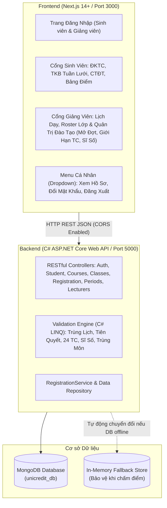

# Hệ Thống Đăng Ký Tín Chỉ & Quản Lý Học Vụ (UniCredit Portal)

> **Dự án Bài tập lớn (BTL):** Xây dựng Cổng Đăng ký Tín chỉ & Quản lý Học vụ Trực tuyến theo chuẩn đào tạo đại học tín chỉ, tham khảo luồng nghiệp vụ thực tế của **Cổng Đào tạo Học viện Công nghệ Bưu chính Viễn thông (qldt.ptit.edu.vn)**. Hệ thống mang bộ nhận diện độc lập, giao diện phẳng chuẩn mực, dịu mắt, bo góc vừa phải và hiệu ứng hoạt họa mượt mà.

---

## 🌟 Điểm Nổi Bật Về Giao Diện & Trải Nghiệm Người Dùng (UI/UX)

- **Tone màu học thuật (Academic Flat):** 
  - Phần trên cùng của web (Header/Topbar) sử dụng **Màu đỏ trầm học thuật** (`#991B1B` / `bg-red-800`), đồng bộ với nền Off-White (`#F8FAFC`) và các ô bảng Slate (`#0F172A`).
  - **Tuyệt đối không dùng gradient màu mè:** Giữ mắt sinh viên luôn thoải mái, chống mỏi mắt khi phải tra cứu lịch học trong thời gian dài.
- **Font chữ chuẩn quốc tế:** Áp dụng toàn diện font **`Helvetica, Arial, sans-serif`** cho nét chữ rõ ràng, thanh thoát.
- **Bo góc chuẩn mực (`rounded-md` 6px - 8px):** Không bo tròn quá mức dạng viên thuốc, tạo sự nghiêm túc, tin cậy của một cổng học vụ trường đại học.
- **Live Timetable Preview (Tính năng xem trước kíp học độc đáo):** Rê chuột (hover) vào bất kỳ lớp học phần nào ở danh sách mở, ô kíp học tương ứng trên Thời khóa biểu tuần thu nhỏ sẽ hiển thị ngay khung nét đứt màu xanh (hoặc màu đỏ cảnh báo nếu bị trùng) giúp sinh viên nhận biết ngay trước khi bấm đăng ký.
- **Micro-UX & Animations:** Tích hợp `Framer Motion` cho hiệu ứng chuyển tab mềm mại (180ms), hiệu ứng pháo hoa nhẹ khi đăng ký thành công.

---

## 🏛️ Kiến Trúc Hệ Thống (Client - Server Architecture)



---

## 📁 Cấu Trúc Thư Mục Dự Án

```
G:\BTL\Hệ thống đăng kí tín chỉ\
├── run-all.bat                   # File 1-Click khởi động cả Backend và Frontend trong 2 cửa sổ
├── run-backend.bat               # File khởi động nhanh Backend C#
├── run-frontend.bat              # File khởi động nhanh Frontend Next.js
├── package.json                  # Root package.json hỗ trợ lệnh npm chạy từ thư mục gốc
├── .gitignore                    # Bộ lọc Git toàn diện cho cả C#, Next.js, Node và IDE
├── .editorconfig                 # Chuẩn hóa format code (2 spaces cho TS, 4 spaces cho C#)
├── .gitattributes                # Chuẩn hóa line-endings LF / CRLF
│
├── frontend/                     # Ứng dụng Frontend (Next.js 14+, Tailwind CSS, Framer Motion)
│   ├── src/
│   │   ├── app/                  # App Router, Layout, CSS (Helvetica & Arial font)
│   │   ├── components/
│   │   │   ├── Auth/             # Trang Đăng nhập (Sinh viên & Giảng viên)
│   │   │   ├── Lecturer/         # Cổng Giảng viên (Lịch dạy, Danh sách lớp & Roster SV)
│   │   │   ├── Registration/     # Đăng ký tín chỉ, Giỏ môn, Live Timetable Preview
│   │   │   ├── Timetable/        # Thời khóa biểu tuần lưới 7 ngày x 12 tiết, xuất .ICS
│   │   │   ├── Curriculum/       # Cây Chương trình đào tạo 8 kỳ & Tiên quyết
│   │   │   ├── Transcript/       # Bảng điểm, CPA, GPA, Xếp loại học lực
│   │   │   └── Admin/            # Cổng Quản trị đào tạo (Đóng/mở đợt, Sĩ số)
│   │   └── lib/                  # api-client.ts, Thuật toán ràng buộc, Dữ liệu mẫu
│   └── test/                     # Bộ kiểm thử tự động TypeScript cho validation engine
│
└── backend/                      # Backend C# ASP.NET Core Web API & MongoDB
    ├── UniCredit.slnx            # Solution file mở bằng Visual Studio 2022 / Rider / VS Code
    ├── UniCredit.Api/            # Dự án Web API C# (.NET 10.0)
    │   ├── Controllers/          # Auth, Student, Courses, Classes, Registration, Periods, Lecturers
    │   ├── Services/             # RegistrationService, RegistrationValidationService
    │   ├── Models/               # Student, Course, CourseClass, RegistrationPeriod, Lecturer
    │   ├── Data/                 # MongoDbContext, DbSeeder, MongoDbSettings
    │   └── DTOs/                 # ApiResponse<T>, Requests
    └── UniCredit.Tests/          # Bộ kiểm thử tự động xUnit bằng C# cho 5 quy tắc học vụ
```

---

## 🔐 Tài Khoản Đăng Nhập Mẫu Để Demo Nhanh

Giao diện đăng nhập đã tích hợp sẵn các nút **1-Click Login** tiện lợi:

| Vai trò | Mã đăng nhập | Mật khẩu | Thông tin chi tiết |
| :--- | :--- | :--- | :--- |
| **Sinh viên** | `B21DCCN001` | `123456` | Nguyễn Hoàng Minh • Khóa K21 CNTT • Lớp D21CQCN01-B |
| **Giảng viên 1** | `GV01` | `123456` | TS. Hoàng Xuân Dậu • Phụ trách môn Lập trình Web và ứng dụng |
| **Giảng viên 2** | `GV02` | `123456` | PGS.TS Vũ Hữu Tiến • Phụ trách môn Mạng máy tính |

*(Kèm mã xác thực Captcha 4 số hiển thị trực tiếp trên giao diện).*

---

## 🚀 Hướng Dẫn Khởi Chạy Dự Án

### Cách 1: Sử dụng File Chạy Tự Động 1-Click (Khuyên dùng)
Tại thư mục gốc dự án:
- Click đúp vào file **[`run-all.bat`](file:///G:/BTL/H%E1%BB%87%20th%E1%BB%91ng%20%C4%91%C4%83ng%20k%C3%AD%20t%C3%ADn%20ch%E1%BB%89/run-all.bat)**.
- Hệ thống sẽ tự động bật 2 cửa sổ chạy song song:
  - **Backend C#:** `http://localhost:5000` (Swagger: `http://localhost:5000/swagger`)
  - **Frontend:** `http://localhost:3000`

---

### Cách 2: Khởi chạy bằng Dòng lệnh Terminal (Từ Thư mục gốc)
Mở 2 cửa sổ PowerShell tại thư mục `G:\BTL\Hệ thống đăng kí tín chỉ`:

**Cửa sổ 1 - Khởi động Backend C#:**
```powershell
npm run backend
# Hoặc: dotnet run --project backend/UniCredit.Api
```

**Cửa sổ 2 - Khởi động Frontend Next.js:**
```powershell
npm run dev
```

Truy cập trình duyệt: **`http://localhost:3000`**

---

## 🧪 Kiểm Thử Tự Động (Automated Tests)

### 1. Kiểm thử Backend C# (xUnit):
```powershell
dotnet test backend/UniCredit.slnx
```
> Kết quả: **`Passed! - Failed: 0, Passed: 7, Skipped: 0`** (Kiểm tra kíp giao nhau, kíp liền kề, khác thứ, chặn môn F chưa qua tiên quyết, vượt 24 TC, lớp đầy sĩ số, trùng môn).

### 2. Kiểm thử Frontend (TypeScript):
```powershell
npm test
```
> Kết quả: **`TẤT CẢ 5 BỘ KIỂM THỬ RÀNG BUỘC HỌC VỤ ĐÃ VƯỢT QUA 100%!`**

---

## 🛠️ Danh Sách Các RESTful API Endpoints (Backend C#)

Tất cả các API đều có Swagger UI tương tác trực tiếp tại: **`http://localhost:5000/swagger`**

| Method | Endpoint | Mô tả |
| :--- | :--- | :--- |
| `POST` | `/api/auth/login` | Đăng nhập tài khoản Sinh viên / Giảng viên (kèm vai trò & token) |
| `GET` | `/api/student?code={code}` | Lấy thông tin sinh viên, CPA, lịch sử bảng điểm chi tiết |
| `GET` | `/api/courses` | Lấy danh mục môn học (lọc theo kỳ CTĐT, học lại F, cải thiện D, tìm kiếm) |
| `GET` | `/api/classes?periodId={id}` | Lấy danh sách lớp học phần và sĩ số thời gian thực |
| `POST` | `/api/register` | Đăng ký lớp học phần (Kiểm tra 5 ràng buộc học vụ tự động) |
| `DELETE`| `/api/register` | Hủy đăng ký lớp học phần (Giải phóng slot và trừ học phí) |
| `GET` | `/api/periods` | Lấy thông tin đợt đăng ký tín chỉ hiện tại |
| `POST` | `/api/periods` | Cấu hình mở/đóng đợt, số tín chỉ min/max (Dành cho Admin) |
| `GET` | `/api/lecturers` | Lấy danh sách giảng viên toàn trường |
| `GET` | `/api/lecturers/{code}/classes` | Lấy danh sách lớp học phần do giảng viên phụ trách |
| `POST` | `/api/seed` | Nạp lại bộ dữ liệu mẫu vào MongoDB |

---

## 📋 Kịch Bản Demo Nghiệp Vụ Khi Thuyết Trình BTL

1. **Demo Đăng nhập 2 vai trò & Dropdown Menu người dùng:**
   - Dùng nút 1-click đăng nhập vào tài khoản **Sinh viên (`B21DCCN001`)**.
   - Bấm vào tên sinh viên góc trên bên phải header để mở **Dropdown Menu**:
     - Bấm **"Thông tin cá nhân"**: Xem thẻ sinh viên, lớp hành chính, khóa, GPA/CPA và ngành học.
     - Bấm **"Đổi mật khẩu"**: Form đổi mật khẩu bảo mật có xác thực trực tiếp.
     - Bấm **"Đăng xuất"**: Trở về màn hình đăng nhập chính.
2. **Demo Cổng Giảng viên & Quản trị đào tạo:**
   - Đăng nhập vào tài khoản **Giảng viên (`GV01`)**.
   - Tab 1 **"Lớp học phần phụ trách & Điểm danh"**: Xem lịch dạy, tìm kiếm và in danh sách sinh viên lớp (roster A4).
   - Tab 2 **"Quản trị đào tạo & Giám sát sĩ số"**: Cho phép giảng viên đóng/mở đợt đăng ký, điều chỉnh giới hạn tín chỉ min/max, và theo dõi cảnh báo các lớp dưới 20 sinh viên.
3. **Demo Live Hover Preview:**
   - Tại màn hình đăng ký tín chỉ sinh viên, rê chuột vào lớp `INT1405-01` (Thứ 5, Tiết 1-3).
   - Thời khóa biểu thu nhỏ ở góc phải sẽ lập tức hiển thị khung nét đứt màu xanh tại kíp học đó.
4. **Demo Chặn Trùng Lịch Học (Time Conflict):**
   - Sinh viên đã có lớp `INT1434-01` (Thứ 2, Tiết 1-3).
   - Thử bấm đăng ký lớp `INT1339-01` (Cũng học Thứ 2, Tiết 1-3).
   - Hệ thống lập tức bật hộp thoại cảnh báo màu đỏ phân tích chi tiết hai lớp bị xung đột.
5. **Demo Chặn Điều Kiện Tiên Quyết:**
   - Tìm môn *Học máy chuyên sâu (Deep Learning - `INT14115`)*.
   - Môn này yêu cầu tiên quyết *Trí tuệ nhân tạo (`INT1416`)* mà sinh viên đang bị điểm F.
   - Nút đăng ký bị vô hiệu hóa kèm nhãn cảnh báo *Chưa đủ điều kiện tiên quyết*.
6. **Demo Chặn Lớp Đầy Sĩ Số:**
   - Lớp `INT1434-02` đã đầy 55/55 sinh viên -> Nút bị khóa với nhãn *Lớp đã hết chỗ*.
7. **Demo Giỏ Môn & Tự Động Tính Học Phí:**
   - Bảng đăng ký tự động cộng tổng số tín chỉ và tính học phí (đơn giá 450.000 VNĐ / TC).
   - Bấm nút "Hủy" -> Có modal xác nhận an toàn, giải phóng slot cho lớp.
8. **Demo Xuất Lịch Học:**
   - Chuyển sang tab *Thời khóa biểu tuần*, bấm **"Xuất .ICS"** để tải file lịch tích hợp Google/Apple Calendar, hoặc bấm **"In lịch"** chuẩn khổ A4.
