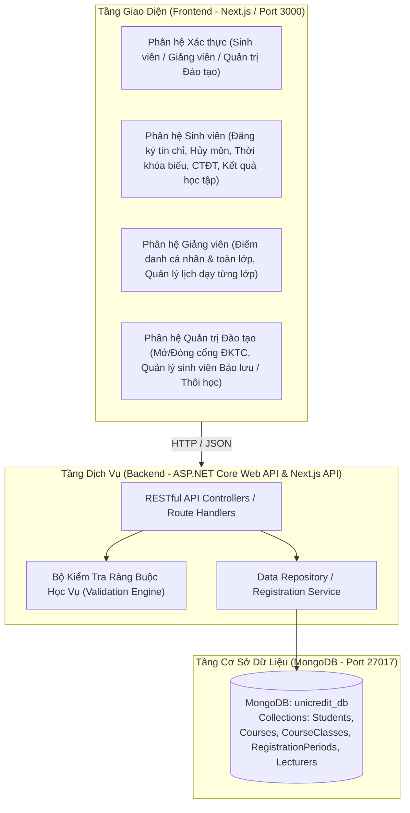

# UniCredit Portal - Hệ Thống Đăng Ký Tín Chỉ Và Quản Lý Học Vụ Trực Tuyến

## 1. Tổng Quan Dự Án

**UniCredit Portal** là hệ thống thông tin quản lý học vụ và đăng ký tín chỉ trực tuyến dành cho bậc đại học, được xây dựng theo chuẩn đào tạo tín chỉ ngành Công nghệ Thông tin.

Hệ thống phân tách rõ ràng ba phân hệ vai trò người dùng độc lập (**Sinh viên**, **Giảng viên** và **Quản trị Đào tạo**), tích hợp bộ kiểm tra ràng buộc học vụ tự động (kiểm tra trạng thái học vụ sinh viên, trùng lịch học, học phần tiên quyết, giới hạn số tín chỉ, sĩ số lớp học phần và học phần đăng ký trùng) cùng cơ sở dữ liệu **MongoDB** lưu trữ tập trung.

---

## 2. Công Nghệ Sử Dụng

| Thành phần | Công nghệ / Thư viện | Mô tả |
| :--- | :--- | :--- |
| **Frontend** | Next.js 16 (App Router), React 19, TypeScript | Xây dựng giao diện người dùng theo từng phân hệ và Route Handlers |
| **Giao diện (UI)** | Tailwind CSS v4, Lucide React, Framer Motion | Thiết kế giao diện học thuật, bố cục cột chức năng thu gọn / mở rộng |
| **Backend API** | C# ASP.NET Core Web API (.NET 10.0) | Cung cấp RESTful API, xử lý nghiệp vụ và kiểm tra ràng buộc |
| **Cơ sở dữ liệu** | MongoDB 7.0 (`unicredit_db`), Mongoose / MongoDB.Driver | Lưu trữ bền vững hồ sơ sinh viên, học phần, lớp học phần, điểm danh, lịch dạy |
| **Kiểm thử (Testing)** | xUnit (.NET), Node Assert / TypeScript (`tsx`) | Kiểm thử đơn vị (Unit Test) cho các thuật toán ràng buộc học vụ |

---

## 3. Kiến Trúc Hệ Thống



---

## 4. Các Chức Năng Chính Theo Từng Phân Hệ

### 4.1. Giao diện điều hướng chung
- **Cột chức năng bên trái có thể thu gọn / mở rộng**: Bố cục cột điều hướng bên trái sử dụng nền trắng, chữ đỏ và phân tách các ô chức năng bằng viền đỏ thẫm, tích hợp duy nhất một nút biểu tượng 3 gạch tại đầu cột để thu gọn hoặc mở rộng không gian làm việc.
- **Quản lý tài khoản trên thanh tiêu đề (Navbar)**: Các tác vụ tài khoản cá nhân (*Thông tin cá nhân*, *Đổi mật khẩu*, *Đăng xuất*) được bố trí tại trình đơn thả xuống góc phải trên cùng của thanh tiêu đề.

### 4.2. Phân hệ Sinh viên (`student`)
- **Đăng ký tín chỉ**:
  - Tra cứu và lọc môn học theo 4 nhóm: *Theo kế hoạch học kỳ*, *Học lại (điểm F)*, *Học cải thiện (điểm D/D+)* và *Tất cả môn trong chương trình đào tạo (lọc theo từng Học kỳ 1 đến Học kỳ 9)*.
  - Xem trước lịch học trực tiếp (Live Schedule Preview) khi di chuột qua từng lớp học phần.
  - Kiểm tra tự động các điều kiện ràng buộc học vụ trước khi lưu đăng ký vào MongoDB:
    1. Kiểm tra đợt đăng ký đang mở.
    2. Kiểm tra trạng thái học vụ của sinh viên (chặn đăng ký nếu sinh viên đang trong diện *Bảo lưu* hoặc *Đã thôi học*).
    3. Kiểm tra đăng ký trùng học phần trong cùng học kỳ.
    4. Kiểm tra điều kiện học phần tiên quyết (sinh viên phải đạt điểm khác F ở môn tiên quyết).
    5. Kiểm tra trùng lịch học theo thứ và tiết học.
    6. Kiểm tra sĩ số tối đa của lớp học phần và giới hạn tín chỉ tối đa trong học kỳ (mặc định 24 tín chỉ).
- **Hủy môn học đã đăng ký**:
  - Quản lý danh sách các lớp học phần đã đăng ký, tổng số tín chỉ và học phí tạm tính.
  - Hỗ trợ hủy lớp học phần có hộp thoại xác nhận, cập nhật trực tiếp vào MongoDB, giảm sĩ số hiện tại của lớp và loại bỏ ngay học phần khỏi bảng danh sách.
- **Thời khóa biểu tuần**:
  - Hiển thị lịch học theo dạng lưới tuần (Thứ 2 đến Thứ 7, Tiết 1 đến Tiết 12) hoặc dạng danh sách chi tiết.
  - Hỗ trợ in lịch học khổ A4 và xuất tệp lịch chuẩn `.ICS` để đồng bộ với Google Calendar hoặc Outlook.
- **Chương trình đào tạo**:
  - Tích hợp đầy đủ 55 học phần thuộc 9 học kỳ chuẩn Chương trình Đào tạo ngành Công nghệ Thông tin.
  - Theo dõi trạng thái từng môn học: *Đã đạt*, *Chưa đạt*, *Đang học kỳ này* hoặc *Chưa học*.
- **Kết quả học tập**:
  - Thống kê điểm trung bình tích lũy toàn khóa (CPA hệ 4), tổng số tín chỉ tích lũy và xếp loại học lực.
  - Phân chia bảng điểm chi tiết theo từng học kỳ độc lập, tính toán tự động số tín chỉ đăng ký, số tín chỉ đạt và điểm trung bình học kỳ (GPA) cho mỗi kỳ.

### 4.3. Phân hệ Giảng viên (`lecturer`)
- **Điểm danh sinh viên**:
  - *Chức năng 1 - Đánh điểm danh cho toàn bộ sinh viên của từng lớp*: Áp dụng trạng thái điểm danh đồng loạt (*Có mặt*, *Đi muộn*, *Vắng có phép*, *Vắng không phép*) cho toàn bộ sinh viên thuộc lớp học phần đang chọn và lưu trực tiếp vào MongoDB.
  - *Chức năng 2 - Đánh điểm danh cho từng sinh viên*: Cập nhật trạng thái điểm danh cá nhân kèm ghi chú riêng trên từng dòng sinh viên và lưu lẻ cho từng sinh viên.
  - Thống kê trực tiếp số lượng sinh viên theo từng trạng thái điểm danh và hỗ trợ in phiếu điểm danh lớp học phần.
- **Quản lý lịch dạy cho từng lớp học của giảng viên**:
  - Hiển thị bảng thời khóa biểu lịch dạy tuần trực quan (Thứ 2 đến Thứ 7, Tiết 1 đến Tiết 12) của giảng viên.
  - Cho phép giảng viên điều chỉnh *Thứ giảng dạy*, *Tiết bắt đầu*, *Số tiết học* và *Phòng học / Giảng đường* cho từng lớp học phần phụ trách, tự động kiểm tra chống trùng lịch dạy giữa các lớp của giảng viên trước khi lưu vào MongoDB.

### 4.4. Phân hệ Quản trị Đào tạo (`admin`)
- **Mở cổng hoặc Đóng cổng sinh viên đăng ký tín chỉ**:
  - Điều khiển trực tiếp trạng thái Mở cổng hoặc Đóng cổng đăng ký tín chỉ toàn trường.
  - Cấu hình số tín chỉ tối thiểu và tối đa được phép đăng ký trong học kỳ.
  - Giám sát tỷ lệ lấp đầy sĩ số của toàn bộ các lớp học phần và cảnh báo các lớp có sĩ số thấp.
- **Quản lý hồ sơ và trạng thái học vụ sinh viên**:
  - Tra cứu, lọc danh sách sinh viên theo trạng thái học vụ (*Tất cả*, *Đang theo học*, *Bảo lưu*, *Đã thôi học*).
  - Đánh dấu trực tiếp trạng thái học vụ của từng sinh viên: **Đang theo học (`ACTIVE`)**, **Bảo lưu (`RESERVED`)** hoặc **Đã thôi học (`DROPPED_OUT`)** và lưu trữ bền vững trong MongoDB.

---

## 5. Cấu Trúc Thư Mục

```text
.
├── backend/
│   ├── UniCredit.slnx                  # Solution file cho .NET Backend và dự án kiểm thử
│   ├── UniCredit.Api/                  # Dự án ASP.NET Core Web API (.NET 10.0)
│   │   ├── Controllers/                # Các Controller xử lý RESTful API
│   │   ├── Data/                       # Kết nối MongoDbContext và DbSeeder
│   │   ├── DTOs/                       # Cấu trúc dữ liệu trao đổi (Requests / ApiResponse)
│   │   ├── Models/                     # Các thực thể BSON ánh xạ với MongoDB Collections
│   │   ├── Services/                   # Nghiệp vụ đăng ký, điểm danh, lịch dạy và kiểm tra ràng buộc
│   │   ├── Program.cs                  # Cấu hình DI, CORS, Swagger và khởi tạo ứng dụng
│   │   └── appsettings.json            # Cấu hình chuỗi kết nối MongoDB
│   └── UniCredit.Tests/                # Dự án kiểm thử đơn vị xUnit
│
├── frontend/
│   ├── src/
│   │   ├── app/                        # Next.js App Router, trang chính và API Route Handlers
│   │   ├── components/
│   │   │   ├── Admin/                  # Giao diện Quản trị Đào tạo (Mở/Đóng cổng & Hồ sơ sinh viên)
│   │   │   ├── Auth/                   # Giao diện đăng nhập 3 vai trò (Sinh viên, Giảng viên, Quản trị ĐT)
│   │   │   ├── Curriculum/             # Giao diện tra cứu Chương trình đào tạo 9 học kỳ
│   │   │   ├── Lecturer/               # Giao diện Giảng viên (Điểm danh cá nhân/toàn lớp & Quản lý lịch dạy)
│   │   │   ├── Modals/                 # Hộp thoại Thông tin cá nhân và Đổi mật khẩu
│   │   │   ├── Registration/           # Giao diện Đăng ký tín chỉ, Bộ lọc và Bảng hủy môn
│   │   │   ├── Timetable/              # Giao diện Thời khóa biểu tuần
│   │   │   ├── Transcript/             # Giao diện Kết quả học tập chia theo từng học kỳ
│   │   │   ├── ConflictModal.tsx       # Hộp thoại cảnh báo vi phạm ràng buộc đăng ký
│   │   │   ├── Navbar.tsx              # Thanh tiêu đề hệ thống và menu tài khoản
│   │   │   └── NavigationTabs.tsx      # Cột chức năng bên trái (thu gọn / mở rộng)
│   │   ├── lib/                        # Kết nối MongoDB, Data Repository, Validation, API Client
│   │   ├── models/                     # Mongoose Schemas (Student, Course, CourseClass, Lecturer, Period)
│   │   └── scripts/                    # Script khởi tạo dữ liệu mẫu vào MongoDB (seed.ts)
│   ├── test/                           # Kiểm thử đơn vị cho thuật toán ràng buộc phía Frontend
│   └── package.json                    # Cấu hình thư viện và scripts phía Frontend
│
├── .editorconfig                       # Quy chuẩn định dạng mã nguồn
├── .gitattributes                      # Quy chuẩn ký tự xuống dòng
├── .gitignore                          # Danh sách loại trừ tệp khi quản lý phiên bản Git
├── package.json                        # Scripts điều phối chung tại thư mục gốc
└── README.md                           # Tài liệu mô tả dự án
```

---

## 6. Yêu Cầu Hệ Thống Và Cài Đặt

### 6.1. Yêu cầu môi trường
- **Node.js**: Phiên bản 20.x trở lên.
- **.NET SDK**: Phiên bản 10.0 (nếu chạy kèm Backend C#).
- **MongoDB Server**: Phiên bản 7.0 trở lên chạy tại cổng mặc định `27017` (dự án đã tích hợp sẵn máy chủ MongoDB cục bộ tại thư mục `.mongodb/`).

### 6.2. Cài đặt gói phụ thuộc
Mở cửa sổ dòng lệnh tại thư mục gốc của dự án và thực hiện:

```bash
cd frontend
npm install
```

### 6.3. Cấu hình biến môi trường
1. Tại thư mục `frontend/`, tạo hoặc kiểm tra tệp `.env.local`:
   ```env
   PORT=3000
   NEXT_PUBLIC_API_URL=http://localhost:5000
   MONGODB_URI=mongodb://127.0.0.1:27017/unicredit_db
   ```
2. Tại thư mục `backend/UniCredit.Api/`, kiểm tra tệp `appsettings.json`:
   ```json
   {
     "MongoDbSettings": {
       "ConnectionString": "mongodb://127.0.0.1:27017",
       "DatabaseName": "unicredit_db"
     }
   }
   ```

---

## 7. Hướng Dẫn Khởi Chạy

### Cách 1: Khởi chạy tự động toàn bộ dịch vụ (Windows)
Chạy tệp `run-all.bat` tại thư mục gốc để hệ thống tự động khởi động tuần tự 3 dịch vụ:
1. **MongoDB Server**: `mongodb://127.0.0.1:27017/unicredit_db`
2. **Backend ASP.NET Core API**: `http://localhost:5000` (Tài liệu Swagger: `http://localhost:5000/swagger`)
3. **Frontend Next.js**: `http://localhost:3000`

### Cách 2: Khởi chạy thủ công qua dòng lệnh

1. **Khởi động MongoDB Server**:
   ```powershell
   .\.mongodb\bin\mongod.exe --dbpath .\.mongodb\data --port 27017 --bind_ip 127.0.0.1
   ```
2. **Khởi tạo dữ liệu chuẩn vào MongoDB (chạy lần đầu hoặc khi cần làm mới dữ liệu)**:
   ```powershell
   cd frontend
   npm run db:seed
   ```
3. **Khởi động Backend C# (.NET)**:
   ```powershell
   dotnet run --project backend/UniCredit.Api
   ```
4. **Khởi động Frontend Next.js**:
   ```powershell
   cd frontend
   npm run dev
   ```
   Sau khi khởi động, truy cập ứng dụng tại địa chỉ: `http://localhost:3000`.

---

## 8. Tài Khoản Thử Nghiệm

| Vai trò | Mã định danh | Mật khẩu | Mô tả |
| :--- | :--- | :--- | :--- |
| **Sinh viên** | `B21DCCN001` | `123456` | Nguyễn Hoàng Minh - Lớp D21CQCN01-B (Đang theo học) |
| **Sinh viên** | `B21DCCN120` | `123456` | Vũ Thu Hà - Lớp D21CQCN03-B (Đang bảo lưu) |
| **Sinh viên** | `B21DCCN203` | `123456` | Ngô Gia Huy - Lớp D21CQCN04-B (Đã thôi học) |
| **Giảng viên** | `GV01` | `123456` | TS. Hoàng Xuân Dậu - Khoa Công nghệ Thông tin 1 |
| **Giảng viên** | `GV02` | `123456` | PGS.TS Vũ Hữu Tiến - Khoa Mạng và Truyền thông |
| **Quản trị Đào tạo** | `ADMIN01` | `123456` | ThS. Nguyễn Văn Quản Trị - Phòng Đào tạo Đại học |

---

## 9. Danh Mục RESTful API

| Phương thức | Đường dẫn (Endpoint) | Chức năng |
| :--- | :--- | :--- |
| `POST` | `/api/auth/login` | Xác thực đăng nhập cho Sinh viên, Giảng viên hoặc Quản trị Đào tạo |
| `GET` | `/api/student?code={studentCode}` | Truy vấn hồ sơ chi tiết của một sinh viên |
| `GET` | `/api/student?all=true` | Truy vấn danh sách toàn bộ sinh viên phục vụ quản lý học vụ và điểm danh |
| `PATCH` | `/api/student` | Cập nhật trạng thái học vụ sinh viên (`ACTIVE`, `RESERVED`, `DROPPED_OUT`) |
| `GET` | `/api/courses` | Truy vấn danh sách toàn bộ 55 học phần thuộc 9 học kỳ trong CTĐT |
| `GET` | `/api/classes?periodId={periodId}` | Truy vấn danh sách các lớp học phần mở trong đợt đăng ký |
| `PATCH` | `/api/classes` | Lưu kết quả điểm danh sinh viên (`action: "attendance"`) hoặc cập nhật lịch dạy lớp học phần (`action: "schedule"`) |
| `POST` | `/api/register` | Đăng ký lớp học phần mới (thực thi kiểm tra ràng buộc và lưu vào MongoDB) |
| `DELETE` | `/api/register` | Hủy lớp học phần đã đăng ký (cập nhật lại sĩ số và danh sách trong MongoDB) |
| `GET` | `/api/periods` | Truy vấn thông tin cấu hình đợt đăng ký hiện hành |
| `POST` | `/api/periods` | Mở hoặc đóng cổng đăng ký tín chỉ và cập nhật giới hạn tín chỉ tối thiểu/tối đa |
| `GET` | `/api/lecturers` | Truy vấn danh sách giảng viên |
| `POST` | `/api/seed` | Khôi phục và nạp lại dữ liệu gốc vào MongoDB |

---

## 10. Kiểm Thử Tự Động

Hệ thống đi kèm bộ kiểm thử đơn vị (Unit Tests) nhằm xác minh tính chính xác của các thuật toán kiểm tra ràng buộc đăng ký tín chỉ ở cả hai phía Backend và Frontend:

- **Chạy kiểm thử phía Backend C# (xUnit)**:
  ```powershell
  dotnet test backend/UniCredit.slnx
  ```
- **Chạy kiểm thử phía Frontend (TypeScript)**:
  ```powershell
  cd frontend
  npm test
  ```
